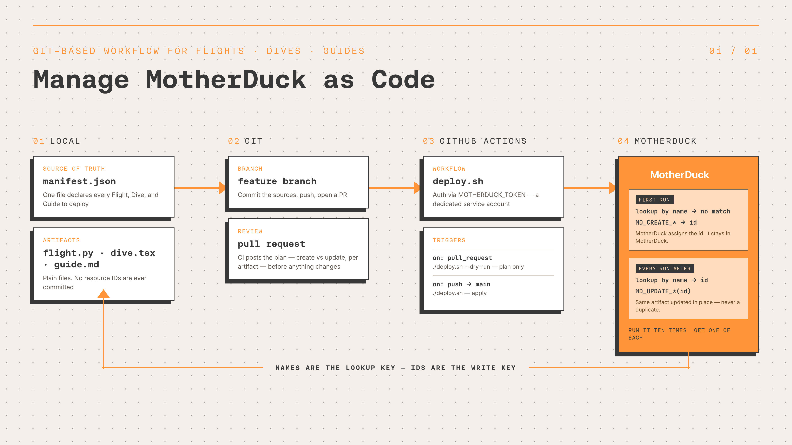

# MotherDuck as Code — a worked example

Managing MotherDuck resources the way you manage application code: declared in a repository, reviewed in a pull request, deployed by CI. Two **Flights**, five **Dives**, six **Guides**, and a **share** — all reconciled by one bash script that calls the `MD_*` SQL functions directly.

The artifacts are just a vehicle. **What this repository is actually showing you is the mechanics**: how a deploy decides between creating and updating, how file contents get into a table function, why order matters, and which parts drift if you don't reconcile them.



| Artifact | Name |
| --- | --- |
| Database + share | `agent_commerce` |
| Flights | `agent-commerce-monthly-rollup` · `gdrive-sheets-sync` |
| Dives | `Agent Commerce Overview` · `Overall Usage Monitoring` · `Dive Usage Monitoring` · `MCP Usage Monitoring` · `Flight Usage Monitoring` |
| Guides | `MotherDuck as Code — orientation` · `Agent commerce metrics` · `Revenue run-rate and trend` · `Usage monitoring with QUERY_HISTORY` · `Dive conventions` · `Flight conventions` |

---

# How it works

## 1. One manifest holds the desired state

`manifest.json` is the only file you edit to change what deploys. It names every artifact, points at its source file, and declares the properties the repository owns — a Flight's schedule, config, and secret names, a Dive's `required_resources` and `status`, a Guide's topic and visibility.

Everything else follows from it. `deploy.sh` reads the manifest, and nothing is hardcoded in the script that a user would reasonably want to change.

## 2. Create once, then update by ID

There is no state file and **no resource IDs committed anywhere**. Every run asks MotherDuck what already exists, then branches.

**First run** — the lookup returns nothing, so the deployer creates and MotherDuck assigns an ID:

```
lookup by name  ->  (no match)  ->  MD_CREATE_FLIGHT / MD_CREATE_DIVE / MD_CREATE_GUIDE
```

**Every run after** — the lookup finds it, and the deployer updates *by the ID it just resolved*:

```
lookup by name  ->  id  ->  MD_UPDATE_FLIGHT(flight_id => id)
                            MD_UPDATE_DIVE_CONTENT(id) + MD_UPDATE_DIVE_METADATA(id)
                            MD_UPDATE_GUIDE(id)        + MD_UPDATE_GUIDE_METADATA(id)
```

Names are the **lookup** key; IDs are the **write** key. The name is what you version in Git; the ID never leaves MotherDuck. That split is what makes the script idempotent — run it ten times, get one of each.

| Artifact | Looked up by | Then written by |
| --- | --- | --- |
| Flight | `flight_name` via `MD_LIST_FLIGHTS()` | `flight_id` |
| Dive | `title` via `MD_LIST_DIVES()` | `id` |
| Guide | `title` + `topic` via `MD_LIST_GUIDES()` | `id` |

`./deploy.sh --dry-run` shows which branch each artifact takes before anything runs:

```
ACTION   TYPE           NAME
update   flight         agent-commerce-monthly-rollup
update   dive           Agent Commerce Overview
create   dive           Dive Usage Monitoring
update   guide          Agent commerce metrics
```

## 3. Getting a file into a table function

`MD_CREATE_DIVE`, `MD_CREATE_GUIDE`, and `MD_CREATE_FLIGHT` are **table functions**, so their arguments must be literals. Both obvious ways to pass a file's contents fail:

```sql
-- Binder Error: read_text is a table function and must be called in a FROM clause
SELECT id FROM MD_CREATE_DIVE(content = read_text('dive.tsx'), ...);

-- Binder Error: Table function cannot contain subqueries
SELECT id FROM MD_CREATE_DIVE(content = (SELECT content FROM read_text('dive.tsx')), ...);
```

`SET VARIABLE` accepts the subquery, and `getvariable()` hands the result to the table function as a scalar:

```sql
SET VARIABLE content = (SELECT content FROM read_text('dive.tsx'));
SELECT id FROM MD_CREATE_DIVE(title = 'My Dive', content = getvariable('content'), api_version = 1);
```

No heredocs, no dollar-quoting, no shell-escaping a 25 KB `.tsx`. The same trick applies to **reads** — `MD_GET_DIVE(id = (SELECT ...))` fails too, so resolve the ID into a variable first.

## 4. Deploy order is load-bearing

**Flights → run the ones that opt in → Dives → Guides.**

The `Agent Commerce Overview` Dive declares `md:agent_commerce_marts` in its `required_resources` — a database the Flight creates. Publish the Dive first and it references a table that doesn't exist yet, so `deploy.sh` waits for the Flight run to reach `RUN_STATUS_SUCCEEDED` before touching any Dive.

That prefix matters: run statuses are `RUN_STATUS_SUCCEEDED` / `_FAILED` / `_CANCELLED`. Comparing against a bare `SUCCEEDED` is valid code that never matches, so a wait loop written that way hangs until timeout and then fails a run that actually succeeded.

Not every Flight wants that. `run_on_deploy` decides per Flight whether the deploy runs it and blocks on the result — see the next section.

## 5. Flights are configured from the manifest, secrets included

The two Flights do unrelated jobs, and every difference between them lives in their manifest entries rather than in `deploy.sh`:

- **`agent-commerce-monthly-rollup`** reads the `agent_commerce` share and rebuilds `agent_commerce_marts.monthly_spend`, weekly.
- **`gdrive-sheets-sync`** walks Google Drive folder trees, expands every tab of every Google Sheet it finds, and loads each one into `google_drive`, daily — skipping any file whose Drive `modifiedTime` has not moved since its last fully-successful load.

**`config` becomes environment variables.** Each key in the manifest's `config` map is passed through as `MAP { 'KEY': 'VALUE' }` and surfaced to `flight.py` under the same name, so keys are UPPERCASE by convention. Values are always strings — a list travels as a JSON-encoded string the Flight parses (`ROOT_FOLDER_IDS`, `EXCLUDE_PATTERNS`). Nothing sensitive belongs here; `config` is committed.

**Secrets are referenced by name, never committed.** Create the secret once, by hand:

```sql
CREATE SECRET gsheets IN MOTHERDUCK (
  TYPE FLIGHTS,
  PARAMS MAP { 'SERVICE_ACCOUNT_JSON': '{"type":"service_account", ...}' }
);
```

The repository only names it — `"secrets": ["gsheets"]` in the manifest becomes `flight_secret_names => ['gsheets']` on the create or update. At runtime every key in that `PARAMS` map arrives as an environment variable **twice**: namespaced as `gsheets_SERVICE_ACCOUNT_JSON` (the secret's name, case preserved, not upper-cased) and again bare as `SERVICE_ACCOUNT_JSON`. Prefer the namespaced form, because bare names can collide between two attached secrets, or with a `config` key.

**`run_on_deploy: false` deploys a Flight without running it.** The default is `true`, which is what `agent-commerce-monthly-rollup` needs — the Dive deployed next reads the database that run creates. `gdrive-sheets-sync` sets it `false`:

```
Updating flight 'gdrive-sheets-sync' (a2f1c0d4-…)...
  Skipping run for 'gdrive-sheets-sync' (run_on_deploy=false).
```

It calls the Google Drive API, and a run that fails for credentials CI may not hold would fail the *entire* deploy — including the Dives and Guides that have nothing to do with it. Its own `DISCOVER_ONLY=true` config covers the safe-check case instead: walk Drive, resolve and print every target table name, then return before connecting to MotherDuck at all.

**`SKIP_UNCHANGED` makes the scheduled run pay only for change.** Flights bill by the second of runner time plus Duckling compute while loading, so a daily sync of sheets that rarely change would mostly pay for re-loading data it already has. Drive returns each file's `modifiedTime` in the same `files.list` responses the folder walk already makes, and the Flight records it per file in `google_drive.main.gsheets_sync_state` after a fully-successful load. The next run reloads a file only when its `modifiedTime` moved, a target table went missing (dropping a table in MotherDuck must not require editing the sheet to get it back), or any of its tabs failed last time — a failed tab deletes the file's watermark so the whole file retries. A run where nothing changed reads one small state table and exits in seconds, before the gsheets extension or the Drive credentials ever reach the query path. Set `SKIP_UNCHANGED=false` to force a full reload; the failure mode of the detection is always a redundant reload, never a missed update, because an unknown `modifiedTime` loads unconditionally.

**A Flight is one file, so the tests reach into it.** `MD_CREATE_FLIGHT.source_code` takes a single-file program capped at 200 KB — there are no helper modules to import. The pure logic (slugification, table naming, config parsing, SQL quoting, change detection) lives in `flight.py`, and `tests/` loads it by path with `importlib`:

```bash
pip install pytest==8.3.3
python -m pytest tests/ -v
```

CI runs that in a job the deploy job depends on, so a naming-rule regression fails the pull request before anything touches MotherDuck.

## 6. Reconcile, don't just create

Setting a property at creation makes the repository the source of truth *once*. Checking it on every run makes it the source of truth *continuously*. The test: **if someone changed this in the UI, would the next deploy notice?**

Guide visibility gets that treatment. `access` is declared per guide in the manifest and re-checked every run:

```
Updating guide 'Flight conventions' (de6cbaeb-…)...
  access: organization -> user
```

This matters because the failure is silent and asymmetric — `organization` exposes a guide org-wide, nothing errors, and nobody is notified. A drifted title breaks loudly; a drifted access level just quietly leaks.

Dive `status` gets it too, with a wrinkle: a status is pinned to a **version**, and updating a Dive's content bumps `current_version`. Checking only the status would leave every edit published as a `ready` that describes the *previous* version — so the test covers both:

```
Updating dive 'Overall Usage Monitoring' (bbeee0e7-…)...
  status: ready@v1 -> ready@v2
```

A Dive with no `status` declared is skipped rather than defaulted, because defaulting to `draft` would silently demote a Dive someone had endorsed. Declaring nothing means claiming nothing.

**One hole is left open on purpose.** A Flight's `schedule_cron` and `secrets` are *declared, not reconciled*. `MD_UPDATE_FLIGHT` is a PATCH — omit an argument and the stored value is left untouched, which is exactly what happens when a manifest entry carries no `schedule_cron`. So a schedule someone adds by hand in the UI survives every subsequent deploy, and deleting `schedule_cron` from the manifest does not unschedule anything. Closing it needs a read-modify-write: read the current schedule from `MD_LIST_FLIGHTS()` and send `schedule_cron := ''` only when there *is* one to clear, because blanking a Flight that has no schedule returns an error. The point isn't that every property must be reconciled — it's knowing which of yours are and which aren't.

## 7. Three sharp edges of name-based identity

1. **Renaming creates a second artifact.** The lookup on the new name finds nothing, so the deployer creates and the old one is orphaned. This happened here: retitling `Agent commerce Dive style` to `Dive conventions` left an orphan in the `dives` topic that had to be deleted by hand.
2. **Duplicate names fail the deploy** with a non-zero exit rather than guessing which to update. A Dive built by hand in the UI sharing a title will break CI.
3. **`MD_LIST_*` is identity-scoped, so deploy with a service account token — not a personal one.** Each identity sees only its own artifacts, so switching tokens makes the next run find no match and create a second set. A dedicated service account keeps the upsert stable and keeps the artifacts owned by automation rather than by one person's account.

## 8. Organizing Guides with topics

Guides deploy into a **topic tree**, because that's how an agent finds them without paying to load all of them. It calls `list_guides(topic)`, reads the topic names and counts, and opens only what looks relevant — progressive disclosure.

```
(root)                       MotherDuck as Code — orientation
agent-commerce/              Agent commerce metrics
agent-commerce/forecasting/  Revenue run-rate and trend
platform-observability/      Usage monitoring with QUERY_HISTORY
dives/                       Dive conventions            ← reserved topic
flights/                     Flight conventions          ← reserved topic
```

- **The root is for the one guide always worth loading.** Untopiced guides appear in *every* overview, so they cost tokens every session. The orientation guide earns it by being a map — what lives where, which topic to open next — not a manual.
- **Topic names are all an agent judges before opening.** `agent-commerce` and `platform-observability` say what they cover; `misc` would not.
- **`dives` and `flights` are reserved** for Dive and Flight conventions, reached through their own entry points and excluded from the root overview.

Topics nest with slashes and filter by prefix, so `agent-commerce` also returns `agent-commerce/forecasting`. Keep it shallow. Topics carry no identity — any number of guides can share one, and each guide is still addressed by its UUID.

---

# Copy-paste SQL

Each monitoring dive ships a `queries.sql` beside it with the exact queries it runs, ready to paste straight into a MotherDuck notebook — no React, no repository required.

| File | What it answers |
| --- | --- |
| [`dives/overall-usage-monitoring/queries.sql`](dives/overall-usage-monitoring/queries.sql) | Account-wide compute, every query classified into exactly one workload and attributed by identity — the entry point for the three below |
| [`dives/dive-usage-monitoring/queries.sql`](dives/dive-usage-monitoring/queries.sql) | Which Dives drive compute, on whose ducklings, from which surface |
| [`dives/mcp-usage-monitoring/queries.sql`](dives/mcp-usage-monitoring/queries.sql) | Which MCP clients and users are querying, and how much |
| [`dives/flight-usage-monitoring/queries.sql`](dives/flight-usage-monitoring/queries.sql) | Flight inventory and run health, plus a query that *generates* the fan-out query |

These read only customer-accessible surfaces — `MD_INFORMATION_SCHEMA.QUERY_HISTORY` and the `MD_LIST_*` functions — so they run in your own account unchanged. The first three need org admin on a Business plan; the Flight one is scoped to the calling identity.

