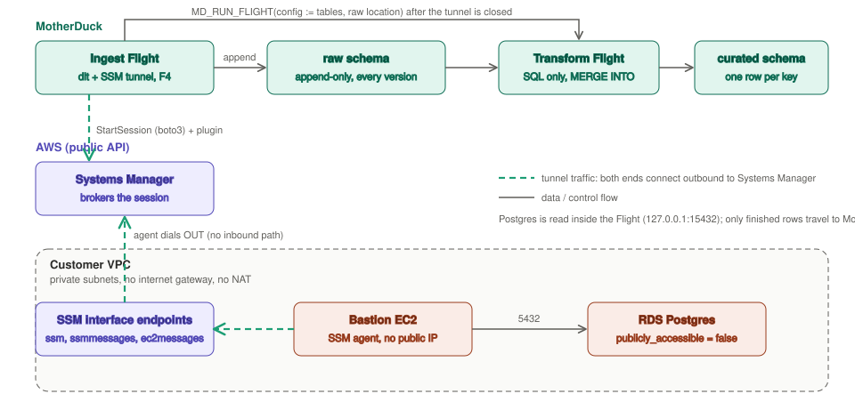

# rds-ssm-dlt-sync

Sync tables from an **RDS Postgres that has no internet path** (private subnets, no internet
gateway, no NAT, `publicly_accessible = false`) into MotherDuck with two Flights. The ingest
Flight reaches the database the same way your engineers do: an **AWS Systems Manager (SSM)
Session Manager port-forwarding session** through a bastion. Nothing is opened inbound on the
VPC and no IP allowlisting is involved.



| Flight | What it does | Depends on |
| --- | --- | --- |
| [`ingest/flight.py`](ingest/flight.py) | Opens the SSM tunnel, runs a [dlt](https://dlthub.com) `sql_database` pipeline against `127.0.0.1`, lands tables **append-only** in `<TARGET_DB>.<raw>`, closes the tunnel, then triggers the transform with `MD_RUN_FLIGHT`. | boto3, dlt, SQLAlchemy, psycopg2 |
| [`transform/flight.py`](transform/flight.py) | SQL only. Discovers the tables in the raw schema, rebuilds snapshot tables, `MERGE INTO`s the incremental ones into `<TARGET_DB>.<curated>` (one current row per key), verifies key counts. | duckdb |

Both Flights print [Flight Explainer](https://motherduck.com/docs/concepts/flights/) markers
(`# @flight` chart, `@flight-run` / `@flight-log` lines), so each run shows as a live step
diagram in the MotherDuck UI.

## Why SSM, and why it works from a Flight

Both ends of an SSM session connect **outbound** to Systems Manager:

- the bastion's SSM agent dials out (through `ssm` / `ssmmessages` / `ec2messages` interface
  endpoints in an isolated VPC, or through a NAT if one exists);
- the client calls `ssm:StartSession`, gets a stream URL and token, and runs
  `session-manager-plugin`, which exposes the tunnel on a local port.

A Flight is a Linux container with internet egress and `subprocess`, so it can do exactly what a
laptop does: call `StartSession` with boto3, unpack the plugin `.deb` to `/tmp` (no root
needed), and listen on `127.0.0.1:15432`. SQL sent over `md:` runs on a Duckling, which cannot
see the Flight's loopback, so the Postgres read runs **inside the Flight** (dlt over
SQLAlchemy) and only finished rows go to MotherDuck.

## What you need on the AWS side

Most teams that already use SSM to reach their database have all of this.

1. **A bastion with the SSM agent** (≥ 3.1.1374.0) in the VPC, instance profile with
   `AmazonSSMManagedInstanceCore`, no public IP needed. Its security group must reach RDS on
   5432, and RDS must accept 5432 from it. The quick check: `aws ssm start-session --target
   <instance-id>` works from your laptop, and the instance shows in **Systems Manager → Fleet
   Manager**.
2. **A path from the bastion to Systems Manager**: interface endpoints for `ssm` and
   `ssmmessages` (`ec2messages` is conventional but optional for port forwarding) with
   `private_dns_enabled = true` and 443 open from the bastion's security group, or a NAT route.
3. **An IAM user for the Flight.** Flights cannot assume an IAM role, so this is a long-lived
   access key. Scope it to the one thing it does:

   ```json
   {
     "Version": "2012-10-17",
     "Statement": [
       {
         "Sid": "StartPortForwardOnly",
         "Effect": "Allow",
         "Action": "ssm:StartSession",
         "Resource": [
           "arn:aws:ec2:<region>:<account-id>:instance/<bastion-instance-id>",
           "arn:aws:ssm:<region>::document/AWS-StartPortForwardingSessionToRemoteHost"
         ],
         "Condition": { "BoolIfExists": { "ssm:SessionDocumentAccessCheck": "true" } }
       },
       {
         "Sid": "ManageOwnSessions",
         "Effect": "Allow",
         "Action": ["ssm:TerminateSession", "ssm:ResumeSession"],
         "Resource": "arn:aws:ssm:<region>:<account-id>:session/${aws:username}-*"
       }
     ]
   }
   ```

   No EC2 or RDS permissions: the Flight makes one API call (`StartSession`), the bastion's
   agent does the forwarding, and Postgres auth is a database user, not IAM. Add an
   `aws:SourceIp` condition for the
   [Flight egress IPs](https://motherduck.com/docs/concepts/flights/#connecting-to-external-systems)
   of your MotherDuck region if your security team wants the key pinned to MotherDuck.
4. **A read-only Postgres user** for the Flight (`SELECT` on the tables to sync).
5. **A cursor column on each incremental table** that the application sets on every write,
   typically `updated_at`. Postgres does not provide one by default; ORMs usually do. A column
   that only exists on insert (`created_at`) never shows updates. Hard deletes are never seen;
   pair incremental tables with soft deletes or an occasional full refresh.

## What you need on the MotherDuck side

Two `TYPE flights` secrets holding **credentials only** (everything else is Flight config):

```sql
CREATE SECRET rds IN motherduck (
  TYPE flights,
  PARAMS MAP {'USER': '<postgres user>', 'PASSWORD': '<password>'}
);
CREATE SECRET ssm IN motherduck (
  TYPE flights,
  PARAMS MAP {'AWS_ACCESS_KEY_ID': '<key id>', 'AWS_SECRET_ACCESS_KEY': '<secret>'}
);
```

They reach the Flight as `rds_USER`, `rds_PASSWORD`, `ssm_AWS_ACCESS_KEY_ID`,
`ssm_AWS_SECRET_ACCESS_KEY`. `MOTHERDUCK_TOKEN` is injected by Flights.

Then create the Flights. The transform goes first because the ingest needs its id. The entries
in [`manifest.snippet.json`](manifest.snippet.json) are the same thing in this repository's
manifest format; they are not in the root `manifest.json` because they need your VPC and your
secrets.

```sql
-- 1. transform (SQL only, F4 is enough)
SELECT flight_id FROM MD_CREATE_FLIGHT(
  name := 'rds-ssm-dlt-transform',
  source_code := $$ ... transform/flight.py ... $$,
  requirements_txt := 'duckdb==1.5.6',
  instance_type := 'F4',
  config := MAP {'CURATED_SCHEMA': 'curated', 'TARGET_DB': '', 'RAW_SCHEMA': '', 'INCREMENTAL_TABLES': ''}
);

-- 2. ingest, pointing at the transform
SELECT flight_id FROM MD_CREATE_FLIGHT(
  name := 'rds-ssm-dlt-ingest',
  source_code := $$ ... ingest/flight.py ... $$,
  requirements_txt := $$ ... ingest/requirements.txt ... $$,
  flight_secret_names := ['rds', 'ssm'],
  config := MAP {
    'AWS_REGION': '<region>',
    'BASTION_INSTANCE_ID': '<i-...>',
    'RDS_HOST': '<private RDS endpoint>',    -- never resolved by the Flight; the bastion resolves it
    'RDS_PORT': '5432',
    'RDS_DATABASE': '<database>',
    'SOURCE_SCHEMA': 'public',
    'TABLES': 'customers,orders',
    'INCREMENTAL_TABLES': 'orders:updated_at:id',
    'INCREMENTAL_MODE': 'append',
    'TARGET_DB': 'rds_sync',
    'TARGET_SCHEMA': 'raw',
    'TRIGGER_FLIGHT_ID': '<flight_id from step 1>',
    'DLT_BACKEND': 'sqlalchemy',
    'SSM_PLUGIN_VERSION': '1.2.896.0'
  }
);
```

Run the ingest once with `MD_RUN_FLIGHT(flight_id := ...)`, watch both runs in the UI (the
ingest's `trigger` step logs the transform's run number), then add a `schedule_cron`.

## Config reference

**Ingest** (all config keys are plain env vars; `validate_config()` fails fast with one message
naming every bad value before the tunnel opens):

| Key | Default | Purpose |
| --- | --- | --- |
| `AWS_REGION`, `BASTION_INSTANCE_ID`, `RDS_HOST`, `RDS_PORT`, `RDS_DATABASE` | | Where to tunnel to. `RDS_HOST` is the **private** endpoint. |
| `SOURCE_SCHEMA` | `public` | Postgres schema |
| `TABLES` | | Comma-separated tables to sync (reflected up front, not the whole schema) |
| `INCREMENTAL_TABLES` | (none) | `table:cursor:key[\|key2],...`. Listed tables are read incrementally (rows at or after the last cursor dlt saw); the rest are full `replace`. The key is what the transform dedupes and merges on. |
| `INCREMENTAL_MODE` | `merge` | `append`: append-only raw, history kept, dedupe downstream (recommended). `merge`: dlt upserts in place (delete+insert via a staging dataset); no transform needed, no history. |
| `TARGET_DB`, `TARGET_SCHEMA` | `rds_sync`, `raw` | Landing database and dlt dataset |
| `TRIGGER_FLIGHT_ID` | (none) | Transform Flight to start after a clean ingest |
| `DLT_BACKEND` | `sqlalchemy` | `pyarrow` is faster on wide tables |
| `SKIP_TUNNEL` | `false` | `true` to run locally against a tunnel you opened yourself |
| `SSM_PLUGIN_VERSION` | `1.2.896.0` | Pinned plugin build |

**Transform.** Stored config is `CURATED_SCHEMA` plus `TARGET_DB`, `RAW_SCHEMA`,
`INCREMENTAL_TABLES` as empty placeholders. The ingest Flight passes the real values per run
through `MD_RUN_FLIGHT(config := MAP {...})`, which can only override keys a Flight already
defines. The table list is **not** configured anywhere on the transform: it discovers every
table in the raw schema (minus dlt's `_dlt_*`). The ingest Flight is the single source of
truth, and MotherDuck records the effective config on each transform run
(`MD_LIST_FLIGHT_RUNS ... config`).

## What a run does

Ingest (`config → plugin → tunnel → probe → target → extract → normalize → load → teardown → trigger`):

1. Validate config and secrets.
2. Download and unpack `session-manager-plugin`, call `StartSession`, hand the token to the
   plugin, which listens on `127.0.0.1:15432`.
3. Probe with a real Postgres handshake (a TCP accept is not enough; the plugin accepts before
   the bastion has reached RDS).
4. `CREATE DATABASE IF NOT EXISTS`, then dlt `sync_destination()` to restore cursors from
   `_dlt_pipeline_state`, `extract`, `normalize`, `load`. Each dlt stage reports its own
   Explainer state; `load` reports one instance per table with the rows written.
5. Close the plugin and terminate the SSM session, always, in `finally`.
6. Trigger the transform with the raw location and the incremental list.

Transform (`config → check → snapshot → merge → verify`):

1. Discover raw tables; fail if an incremental table is not among them.
2. Snapshot tables: `CREATE OR REPLACE TABLE curated.t AS SELECT * EXCLUDE (_dlt_id) FROM raw.t`.
3. Incremental tables: first run builds `curated.t` from a full dedupe of raw. Later runs take
   raw rows with `_dlt_load_id` newer than the max already in curated, dedupe them per key with
   `max_by(row, (cursor, _dlt_load_id))`, and `MERGE INTO curated.t ... WHEN MATCHED AND
   (c.cursor IS NULL OR s.cursor >= c.cursor) THEN UPDATE SET ... WHEN NOT MATCHED THEN INSERT
   (...)`. Curated keeps `_dlt_load_id`, so it is its own watermark; there is no state table.
4. Verify: distinct raw keys == curated rows == curated keys, or the run fails.

## Design notes

- **Append-only raw, then MERGE.** Appends are the cheapest write for the Flight that holds the
  fragile part (the tunnel), raw keeps every version the source ever showed, and curated can be
  dropped and rebuilt from raw without touching Postgres. The price is storage that grows
  forever (decide a retention rule) and one more Flight to watch.
- **No primary keys or indexes anywhere.** A PK in MotherDuck builds an ART index that must fit
  in memory on every build; on large tables that is a known OOM source. dlt's `merge` mode
  creates none either.
- **State survives stateless containers.** dlt stores its cursors in
  `<TARGET_DB>.<raw>._dlt_pipeline_state`; a fresh Flight container restores them on
  `sync_destination()`. Calling `extract/normalize/load` separately skips that call, which is
  why the ingest makes it explicitly.
- **Schema evolution.** New Postgres columns flow into raw as nullable (a
  `table_adapter_callback` relaxes NOT NULL, because DuckDB rejects `ADD COLUMN ... NOT NULL`),
  and the transform adds them to curated before merging. `INSERT` and `UPDATE SET` use explicit
  column lists; a bare `INSERT` in `MERGE INTO` is positional and breaks on column order.
- **Switching a table's cursor column** resets dlt's state for it and re-reads the table once
  into raw. The transform's dedupe absorbs it.
- **In `merge` mode** the ingest passes an empty incremental list, so the transform snapshots
  everything; you can still run it for the curated copy, or skip the transform entirely.

## Limits to know before relying on it

| Constraint | Value | Effect |
| --- | --- | --- |
| Session Manager idle timeout | 20 min default (1–60 configurable) | A long gap with no bytes drops the tunnel; normal loads keep it alive |
| Session Manager max duration | off by default, up to 24 h | If the account sets it, the run must fit inside |
| Tunnel throughput | not documented; a few MB/s per session in practice | The real ceiling. Fine for hundreds of MB per run; above a few GB, stage through S3 with a gateway endpoint instead |
| Flight max runtime | 1 h (Lite/Business), 8 h (Enterprise) | The tunnel lives only as long as the run |
| Per-run setup | plugin download + StartSession + fresh Postgres connection, ~2 s | Batch cadence, not high frequency |

Good fit: tens of tables, hundreds of MB changed per run, hourly or slower, a database that
already has SSM in front of it. Not a fit: sub-minute freshness (use a CDC vendor) or tens of
GB per run (stage through S3).

## Teardown

`MD_DELETE_FLIGHT` both Flights, `DROP DATABASE <TARGET_DB>`, `DROP SECRET rds IN motherduck`,
`DROP SECRET ssm IN motherduck`, and delete the IAM user (which also invalidates its key).
